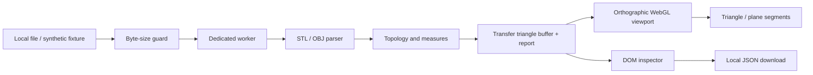

# Architecture

Section Plane is a static TypeScript application. Three.js is the only runtime package. A backend would add a privacy and hosting burden without improving local mesh inspection.

## Boundaries

- `geometry.ts` contains pure parsers and algorithms. No DOM, WebGL, network or storage calls.
- `fixtures.ts` generates reproducible synthetic geometry.
- `worker.ts` parses and analyzes a transferred ArrayBuffer, returning a transferred Float32Array and serializable report. A new import terminates the previous worker; request IDs reject stale responses.
- `viewer.ts` owns GPU resources, orthographic cameras, picking and section rendering. It disposes replaced geometries/materials.
- `main.ts` wires file selection, worker lifecycle, accessible DOM controls and report export.

The application does not persist meshes. Refreshing clears the current document. JSON export is deliberate, user-initiated persistence. No token, account or cloud service is needed.

## Algorithms and cost

STL detection first tests the binary size equation `84 + 50 × triangleCount`. The header text is not trustworthy: binary headers can start with `solid`. ASCII STL uses an explicit facet grammar. OBJ face indices are resolved against previously read vertices. Convex planar polygon faces are fan-triangulated after geometric checks; ambiguous concave and non-planar polygons are rejected.

Analysis walks all coordinates for bounds, then all triangles. Positions are quantized relative to the lower bound, with tolerance `max(largestExtent × 1e-7, 1e-12)`. A hash map assigns welded vertex IDs. Undirected edge keys carry incidence counts and signed orientation. One incident triangle is a boundary; more than two is non-manifold; two incident triangles with the same direction are a winding conflict. Union-find with path compression counts connected components.

Area is half the length of the cross product of triangle edges. The signed volume sum is `dot(a, cross(b, c)) / 6`, with all points translated by the model lower bound to reduce cancellation far from the origin. Volume is withheld on topology/degeneracy failure. These tests do not detect self-intersection or nesting.

For T triangles and V welded vertices, analysis uses expected O(T + V α(V)) time and O(T + V) memory. Hash-map worst cases and JavaScript allocation overhead are not hard real-time bounds. Quantization is approximate and Float32 positions limit coordinate precision.

The section routine visits each triangle, intersects edges against an axis-aligned plane and returns line segments. It is O(T) per slider update. It omits coplanar triangles and does not stitch contours, compute section area or certify watertightness. The supported 200,000-triangle ceiling is a product budget, not a benchmark claim.

## Deliberate tradeoffs

An orthographic camera preserves apparent parallelism and supports comparison across views. It does not change input geometry. Point measurements use ray intersections and straight-line distance, not geodesic distance or CAD snapping. Imported normals are recomputed for display; topology is analyzed using original positions.

No repair is performed automatically. Welding is used for diagnostics only and never modifies the displayed/source triangle positions. A repair product would need a stronger topology representation, robust predicates, self-intersection checks and explicit user review of changed geometry.
